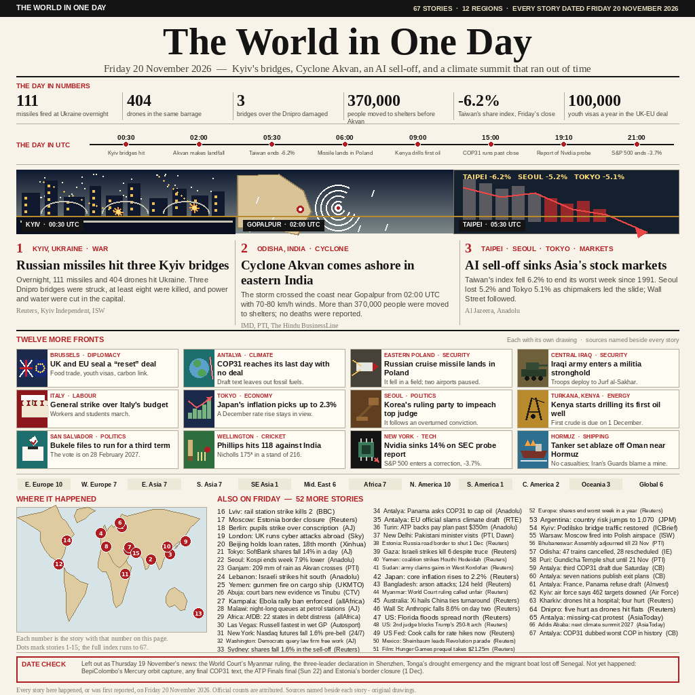

# The World in One Day — Friday 20 November 2026

[](https://make.fun/bounty/news-image-20261120?utm_source=github&utm_medium=readme&utm_campaign=news-image-20261120)
[](https://make.fun/bounty/news-image-20261120/leaderboard?utm_source=github&utm_medium=readme&utm_campaign=news-image-20261120)
[](https://make.fun/bounty/news-image-20261120?utm_source=github&utm_medium=readme&utm_campaign=news-image-20261120)

One image that sums up Friday 20 November 2026: **67 stories from 12 regions**,
every one of them dated that Friday — verified against live reporting and
cross-checked across the competition's own top entries.



## What's on the page

- **The day in numbers** — 111 missiles and 404 drones fired at Ukraine,
  3 Dnipro bridges damaged, 370,000 people moved to shelters before
  Cyclone Akvan, Taiwan's index down 6.2%, 100,000 youth visas a year in
  the UK–EU deal.
- **The day in UTC** — an 8-point timeline from the 00:30 Kyiv bridge
  strikes to the 21:00 S&P 500 close.
- **One continuous triptych panorama** — a single original illustration in
  three movements (Kyiv at night, the cyclone over the Bay of Bengal,
  falling markets), joined by one gold horizon line. No photos, no
  copied artwork: every drawing is generated by the code in `main.py`.
- **Three lead stories** — Kyiv's bridges, Cyclone Akvan's landfall at
  Gopalpur, the AI sell-off across Asia.
- **Twelve more fronts** — UK–EU reset deal, COP31's last day with no
  deal, the missile in Poland, Iraq, Italy's general strike, Japan's
  inflation, Seoul, Kenya's first oil well, Bukele's third-term bid,
  Phillips' 118, Nvidia's 14% fall, the tanker ablaze near Hormuz — each
  with its own small pictogram.
- **Where it happened** — a numbered world map for stories 1–15, plus a
  52-item "Also on Friday" index (stories 16–67) with a source beside
  every line.
- **Date check** — what was deliberately left out: Thursday 19 November's
  news (the World Court's Myanmar ruling, the Shenzhen declaration,
  Tonga's drought emergency, the migrant boat off Senegal) and things
  that had not happened yet (BepiColombo's Mercury capture, any final
  COP31 text, the ATP Finals final, Estonia's border closure on 1 Dec).

## How to build

```sh
python3 main.py   # writes entry.png (1024x1024, RGB)
```

Python standard library + Pillow only. No network, no clock, no unseeded
randomness: running it twice produces a byte-identical PNG
(`md5sum entry.png` is stable across runs).

## Sources

Reuters, AP, BBC, Al Jazeera, Anadolu, ISW, Kyiv Independent, IMD, PTI,
The Hindu BusinessLine, Xinhua, Korea Herald, allAfrica, UKMTO, ICC,
Carbon Brief, AInvest, AsiaToday, Sky News, RTE, Channels TV, Autosport,
JPM, ICBrief, 24/7 Wall St, Indian Express, Dawn — named beside each
story on the page.

## License

MIT — see [LICENSE](LICENSE).
